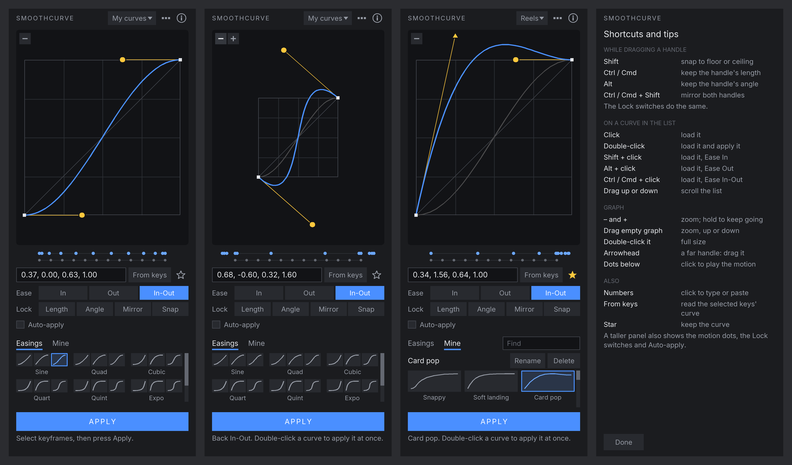

# SmoothCurve

An easing curve panel for [EffectCraft](https://github.com/storytold/effectcraft). Shape a curve
with two handles, or pick one of 25 built-in easings, press Apply, and the curve lands on the
selected keyframes in one undo step.



*The picture is drawn from the panel's own drawing commands by `tools/render.py`, with the font
EffectCraft uses.*

Free to use, change and share (MIT or Apache-2.0). Version 1.2.0, built and tested for
EffectCraft 0.24.1 on macOS. It has not been tried on Windows or Linux yet: if you try it there,
an issue saying what happened is welcome.

SmoothCurve is an independent community panel. It is not made or endorsed by the ArtCraft Team.

## Install

1. Download `SmoothCurve.jsx` from the [latest release](https://github.com/nicolafalcier99/smoothcurve/releases/latest) (or the zip, which
   adds an install note and the licence files).
2. In EffectCraft choose File ▸ Scripts ▸ Install ScriptUI Panel… and pick the file.
3. Open it at the bottom of the Window menu: `SmoothCurve.jsx`. It docks like any panel, and
   EffectCraft opens it again at the next launch if it was open when you quit.

No restart is needed. To update, install the new file the same way, then close the panel's tab
and open it again: an open tab keeps running the old file. Your saved curves are in EffectCraft's
settings, not in the file, so they stay.

It is one file. It makes no network requests, and it writes nothing to disk unless you ask it to
save a library file.

## Use

1. Select keyframes in the timeline.
2. Shape the curve: drag the two yellow handles, click a tile, or click the numbers under the
   graph and type four of your own in the small window that opens. A pasted
   `cubic-bezier(0.42, 0, 0.58, 1)` works too.
3. Press **Apply**. One Undo takes it back.

- **Ease** chooses the sides of each selected keyframe: In (the incoming side, the curve's second
  handle), Out (the outgoing side, its first handle) or In-Out (both). The handle that is not used
  is drawn faint. A keyframe is eased on a side when it has a neighbour there, so a single
  selected keyframe works too.
- **Lock** switches, or keys held while dragging: Shift snaps the handle to the floor or ceiling,
  Ctrl / Cmd keeps its length, Alt keeps its angle, Ctrl / Cmd + Shift moves both handles
  symmetrically. Shift, Alt or Ctrl / Cmd while clicking a tile sets In, Out or In-Out.
- **Auto-apply** applies as soon as you let go of a handle or click a tile. Double-clicking a tile
  applies once without it.
- **From keys**, beside the numbers, reads the curve between the first two selected keyframes.
- The **i** in the header opens a page with every key and click.
- The grid is a square, and it never changes size by itself. At full size it is as large as
  the graph lets it be. A curve that goes beyond the graph is cut at the edge, and a handle that
  is further out appears as an arrowhead on the edge, which can be dragged from there.
- To see how far such a curve goes, zoom out: drag down on the empty part of the graph (up
  zooms back in, a double-click there is the full size), or use the **−** and **+** buttons in
  the graph's top left corner (eight steps, down to about a sixth of the full size; hold a
  button to keep going). The zoom stays where you put it, also at the next launch.
- The graph comes before the presets. When the panel is not tall enough for both, the presets
  keep two rows and scroll: drag the bar beside them, or drag the tiles themselves up and down.
- The dots under the graph show the speed: twelve moments evenly spaced in time, close together
  where the motion is slow. Click them to watch a ball run the curve.

The 25 easings are Linear, and Sine, Quad, Cubic, Quart, Quint, Expo, Circ and Back, each as In,
Out and In-Out. Bounce and Elastic are not there: they cannot be drawn as one curve between two
keyframes.

## Your own curves

The **star** keeps the current curve in your library, on the **Mine** tab. Select one of your
curves to rename or delete it. The name next to the three dots is the active library: click it to
switch, and use the three dots to make, rename, delete, import or export a library.

**Moving a library to another computer.** Three dots ▸ Export shows the library as one line of
text. Click in the field, select all, copy, and send it to yourself. On the other computer: three
dots ▸ Import a library, paste, Import. Importing never replaces a library: one with the same name
arrives as "Name 2".

A file works too, with two limits of EffectCraft 0.24.1: scripts have no file picker, and they may
write files only when Settings ▸ Scripting & Expressions ▸ Allow Scripts to Write Files and Access
Network is on. With it on, type a full path such as `/Users/you/Desktop/Reels.curves.json` on the
Export window and press Save file. On the other computer, type the path in the Import window and
press Load file.

## Limits

- Auto-apply applies when the handle is let go, not while it moves. In EffectCraft 0.24.1 every
  change a panel makes between two mouse events is its own undo step, so applying on the way
  would fill the undo history with one drag.
- Nothing in the panel follows the mouse wheel or a two-finger swipe: EffectCraft 0.24.1 sends a
  script panel no wheel, pinch or key events. So the presets scroll by dragging the tiles or the
  bar, and the graph zooms by dragging.
- What you type, you type in a small floating window, not in the panel: the numbers, a curve's
  name, the search, import and export. In EffectCraft 0.24.1 a docked panel that holds a real
  text field gets the dock's two scroll bars for good and can be slid about by a few pixels (the
  bundled panels do). With no field in it, SmoothCurve has no bars and stays still. The window
  opens in the middle of EffectCraft; a script cannot place it. (EffectCraft's own code has
  had a fix for those bars since 12 November 2026; it is not in 0.24.1.)
- Libraries made by Flow for After Effects (`.flow` files) cannot be read.
- It is written for EffectCraft. It has not been tried in After Effects and would need changes
  there.

## How it is built

```
src/core.js      curve maths, the 25 easings, text parsing, handle rules (no app, no UI)
src/apply.js     the keyframe engine, from EffectCraft's own "Ease Presets.jsx" (credit in the file)
src/store.js     libraries in app.settings, export and import, files
src/ui.js        the panel: layout, painting, mouse, the floating window for typing
build.py         joins the four into dist/SmoothCurve.jsx
tests/           run.py runs everything headless; real_app.py checks the real app (macOS)
tools/           preview.py (a second EffectCraft for tests), render.py and shots.py (pictures),
                 package.py (the release zip)
vendor/          the pinned upstream file the apply engine is checked against
docs/            notes on writing a custom-drawn ScriptUI panel for EffectCraft 0.24.1
```

```sh
python3 -I build.py                       # src/ -> dist/SmoothCurve.jsx
python3 -I tests/run.py                   # 1113 checks, about 50 seconds
```

The tests need `effectcraft-cli` 0.24.1: set `EFFECTCRAFT_CLI` to it, put it on the `PATH`, or
unpack its release folder next to this project. They run headless and keep settings in memory, so
they do not touch your EffectCraft settings. `tests/real_app.py` drives the panel in a second
EffectCraft with its own settings folder (macOS only, see `tools/preview.py`).

What was learned about custom-drawn ScriptUI panels along the way is in
[docs/scriptui-notes.md](docs/scriptui-notes.md). The short version: the panel's speed is the size
of what it draws.

## Credits

- The part that turns a curve into keyframe eases is taken from EffectCraft's bundled panel
  "Ease Presets.jsx", by the ArtCraft Team and the EffectCraft contributors (MIT OR Apache-2.0).
  It handles multi-dimension and spatial properties, roving and hold keyframes. A test compares
  it with the pinned upstream file.
- The idea of the panel, a graph you shape and one Apply button, follows
  [Flow](https://flashbackj.com/product/flow) for After Effects, as seen on its public product
  page and in a public tutorial video. SmoothCurve is not affiliated with Flow or its makers, and
  no code, file, preset or artwork of Flow was used.
- The easing values are the cubic-bezier forms of Robert Penner's easing functions, as listed on
  easings.net and in [postcss-easings](https://github.com/postcss/postcss-easings) (MIT).
- Built with Claude Code (an AI coding agent), then used and corrected by hand in the app.
  Every behaviour described here has a test.

## Licence

MIT or Apache-2.0, at your option: `LICENSE-MIT`, `LICENSE-APACHE`, and `NOTICE` for the
third-party parts.
